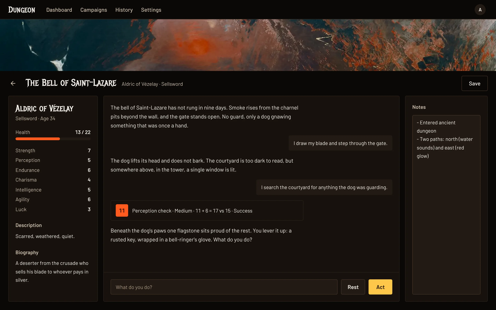
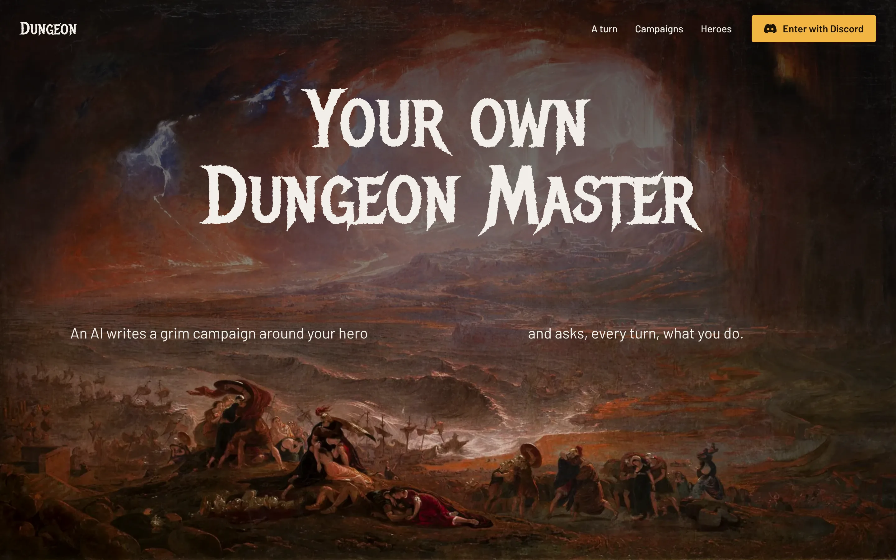
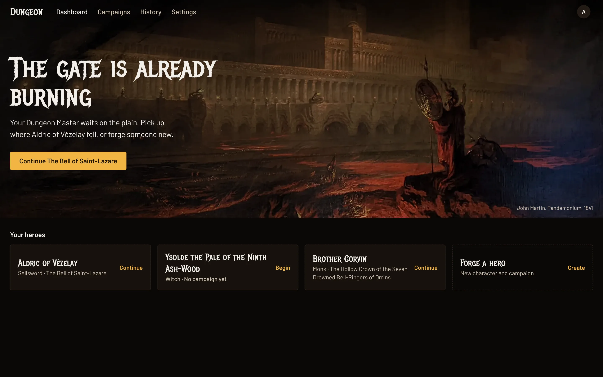
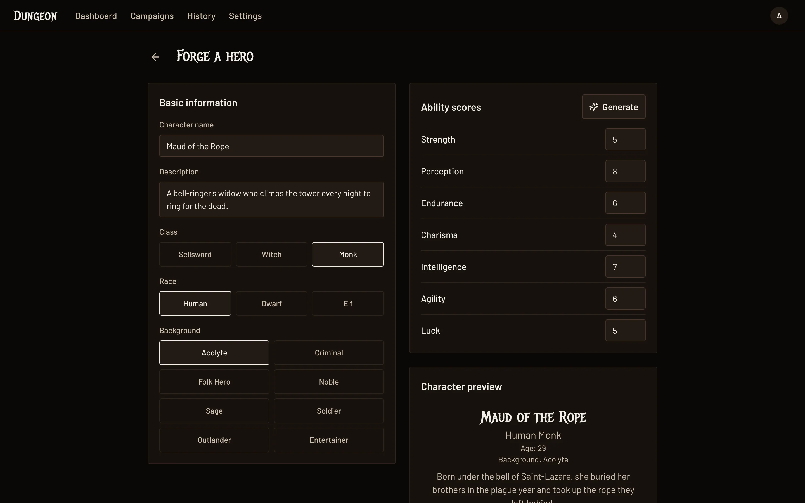
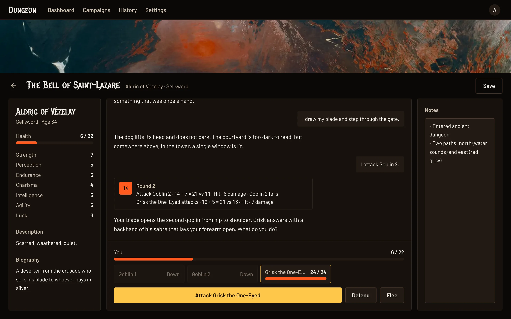
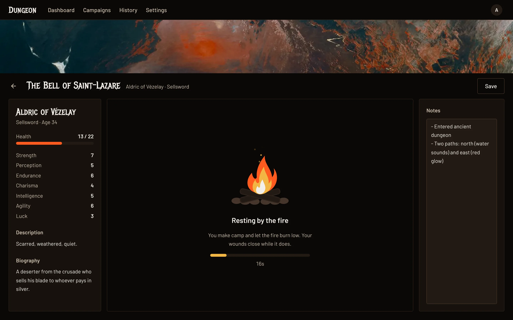

# Dungeon Master AI — Web

React frontend for an AI-powered Dungeon Master app. Create characters, run campaigns, and play through text-based D&D adventures guided by an AI DM.

The campaign view has a 3-panel layout: character sheet on the left, DM chat in the center, and campaign notes on the right.



## Screenshots

| | |
| --- | --- |
|  |  |
| **Landing.** Sign in with Discord. | **Dashboard.** Pick up a campaign or forge a new hero. |
|  |  |
| **Forge a hero.** Describe them; the DM writes the stats and biography. | **Combat.** The server rolls every attack; pick a target, defend or flee. |
|  | |
| **Rest.** Heal by the fire, for as long as the server says. | |

Screenshots use preview mode (`?preview=1`, sample data, no backend); see `CLAUDE.md`.

## Related

- [`../dungeon-service`](../dungeon-service) — Python FastAPI backend (AI DM logic, campaign persistence)

## Prerequisites

- Node.js 18+
- [dungeon-service](../dungeon-service) running locally for AI responses

## Setup

```bash
npm install
npm run dev
```

App runs at `http://localhost:5173`.

## Build

```bash
npm run build   # Output to dist/
```

## Stack

- Vite + React 18 + TypeScript
- React Router v7
- Tailwind CSS v4
- shadcn/ui (Radix UI)
- Motion (animations)
